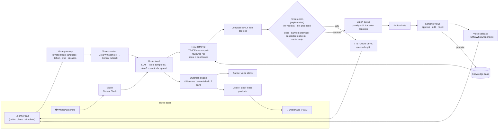

# Architecture

One FastAPI process serves the API, the WebSocket and the built React app on **port 8000**. One SQLite database. Everything external is cached and has a fallback.

## Components

| Piece | File |
|---|---|
| Trust router (whole pipeline) | `backend/app/pipeline/router.py` |
| Nil detection rules | `backend/app/pipeline/nil_detection.py` |
| Retrieval | `backend/app/pipeline/retrieval.py` |
| STT / LLM / TTS / vision | `stt.py`, `llm.py`, `tts.py` |
| Outbreak engine | `backend/app/pipeline/outbreak.py` |
| Scoring and promotion | `backend/app/pipeline/scoring.py` |
| Expert workflow + SLA sweep | `backend/app/api/expert.py` |
| Real-time | `backend/app/ws.py` (one WebSocket, topics `farmer:<id>`, `expert`, `dealer`, `outbreak`, `admin`) |
| Cache (offline replay) | `backend/app/pipeline/cache.py` → `backend/media/cache`, `backend/media/tts` |

## Reliability design
- **Every AI call is cached** by input hash, so rehearsed questions replay instantly and identically, and the free quota is spent once.
- **Fallback chain:** Groq → Gemini → offline rules. The LLM is never needed to decide escalation.
- **Offline switch** (`/admin`): no network calls. It uses cached audio, the KB text verbatim, and typed or sample questions.
- **Explicit thresholds** in `.env`, tunable live.
